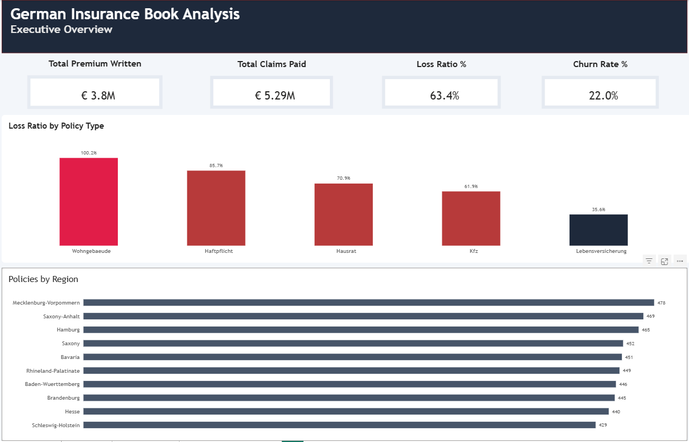
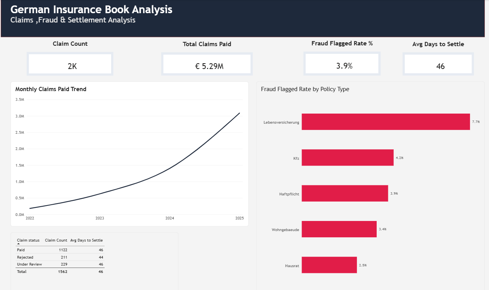
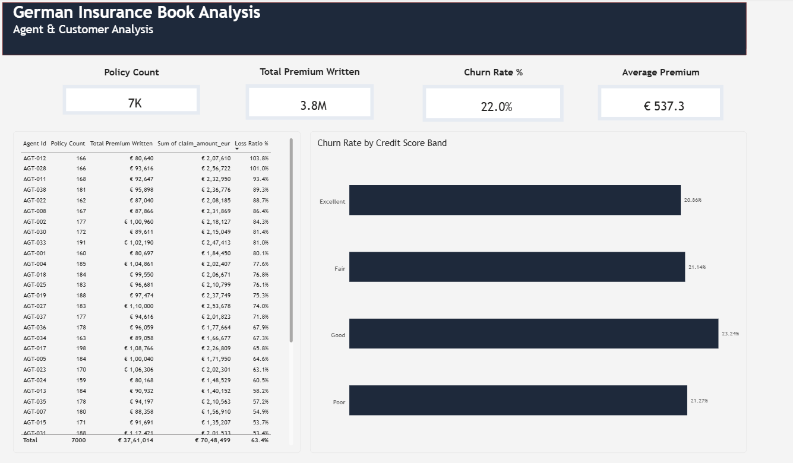

# German Insurance Book Analysis

End-to-end analysis of a synthetic but realistic German personal-lines
insurance book — underwriting KPIs (loss ratio, claims frequency, fraud
signals, churn) across Kfz (auto), Haftpflicht (liability), Hausrat
(household contents), Wohngebaeude (building), and Lebensversicherung
(life) policies.

## Business problem

An insurer's underwriting and claims teams need visibility into which
product lines and regions are profitable, where fraud risk concentrates,
and which customer segments are churning — the same KPIs used at
insurance carriers and their software vendors (e.g. Sapiens core systems)
across the DACH market.

## Dataset

Synthetic data generated with `Faker` (seeded for reproducibility) to
resemble a mid-sized German insurer's book:
- **4,000 customers** across all 16 German states
- **7,000 policies** across 5 product lines, 2022–2025
- **~1,500 claims** with realistic frequency/severity by product line

Schema: `data/raw/customers.csv`, `policies.csv`, `claims.csv`

## Key findings

| Metric | Value |
|---|---|
| Total earned premium | €8.35M |
| Total claims paid | €5.29M |
| **Overall loss ratio** | **63.4%** |
| Overall policy churn rate | 22.0% |

- **Wohngebaeude (building) insurance runs the highest loss ratio (~100%)** —
  this line is the one to re-underwrite or re-price first.
- **Lebensversicherung (life) has the lowest loss ratio (~35%)** but also the
  lowest claim frequency by design — expected given the product structure.
- **Claims paid rise every year (EUR 0.18M in 2022 to EUR 3.09M in 2025)**
  because the book grows: policies start between Jan 2022 and Jun 2025 and
  claims accrue after each start. The loss ratio, which divides by earned
  premium, is the comparable measure, not the claim total.
- **Fraud flags are low and fairly even:** 61 of 1,562 claims (3.9%) are
  flagged for review. By product line the rate runs from 2.5% (Hausrat) to
  7.7% (Lebensversicherung), but life has only 26 claims (2 flagged), so
  that gap is within noise. In this synthetic data the flags are not tied
  to product type, so no line is a genuine fraud hotspot.

`screenshots/` holds the Python charts (`loss_ratio_by_policy_type.png`,
`monthly_claims_trend.png`, `policy_distribution_by_region.png`,
`fraud_flag_rate.png`) and the three Power BI page exports shown below.

## Power BI Dashboard

Interactive 3-page report on insurance profitability, claims and fraud
patterns, and agent performance:
[`powerbi/German Insurance Book Analysis.pbix`](powerbi/German%20Insurance%20Book%20Analysis.pbix)

**Page 1 — Executive Overview**



**Page 2 — Claims, Fraud & Settlement Analysis**



**Page 3 — Agent & Customer Analysis**



## Tech stack

- **Python** (pandas, matplotlib, Faker) — data generation and EDA
- **SQL** (schema + 7 analysis queries with CTEs and window functions)
- **Power BI** — interactive dashboard (see `powerbi/BUILD_GUIDE.md` for
  the exact DAX measures and report layout)

## Repository structure

```
insurance-data-analysis/
├── data/raw/              customers.csv, policies.csv, claims.csv
├── python/
│   ├── generate_data.py   synthetic data generator
│   ├── eda.py             exploratory analysis + chart generation
│   └── EDA.ipynb          notebook version of the EDA (with outputs)
├── sql/
│   ├── 01_schema.sql       table definitions
│   └── 02_analysis_queries.sql   7 business-question queries
├── powerbi/
│   ├── BUILD_GUIDE.md      DAX measures + report page spec
│   └── German Insurance Book Analysis.pbix
├── screenshots/            Python charts + Power BI page exports
└── .gitignore
```

## How to run

```bash
cd python
pip install pandas numpy matplotlib faker
python generate_data.py   # regenerates the CSVs in data/raw/
python eda.py              # runs EDA, writes charts to screenshots/
```

To open the Power BI report, load `powerbi/German Insurance Book Analysis.pbix`
in Power BI Desktop. If the data source path is broken on your machine, use
**Transform data → Data source settings → Change Source** and point it to
the CSVs in `data/raw/`.

Load the schema and run the analysis queries against SQLite, PostgreSQL,
or SQL Server using the files in `sql/`.

## Note on methodology

Loss ratio compares claims paid against **earned premium** (annual premium
× years of policy exposure within the observation window), not raw annual
premium — comparing multi-year claims against a single year of premium
would overstate the ratio. This mirrors how insurers actually calculate
the KPI.
